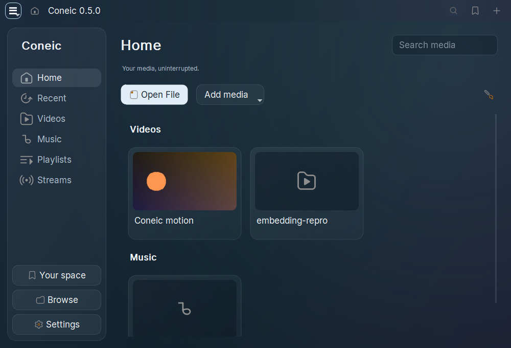

# Coneic

**Windows 0.5.0:** coordinated BlueCloud release with a minimal glass interface, floating playback controls, a standalone installer, portable ZIP, Windows default-player registration and custom icons for 134 media formats. The retained media engine remains VLC 3.0.24. See [Windows file associations](docs/WINDOWS-FILE-ASSOCIATIONS.md) and [build instructions](docs/BUILD.md).

Coneic is a project of **[BLUECLOUD](https://bluecloudai.online)**, its parent company.

Coneic is a desktop media player for Windows x64 and Ubuntu 24.04 x64 built as a source fork of **VideoLAN VLC 3.0.24**. It retains the existing media engine and workflows, adds the supplied Coneic logo and icon, and uses a minimal glass Qt interface. Earlier library and settings work adapts Juxtopposed's VLC Redesign; attribution remains bundled.

**Status: development preview.** Source and package preservation checks pass. Tested native workflows work, with an unresolved Windows standalone libVLC embedding failure documented below. Complete runtime feature parity is not certified.

**0.2.1 Alpha:** Moment Cards, Study Mode, Smart Collections, media relinking, portable library backup, a command palette, customisable Home and refined transport controls. Download the [0.2.1 Alpha prerelease](https://github.com/sadiqgarba2553/coneic/releases/tag/v0.2.1-alpha). See [Alpha instructions](docs/ALPHA-0.2.1.md) and [refinement details](docs/ALPHA-0.2.1-REFINEMENTS.md).

**Linux preview:** a native Ubuntu 24.04 x64 Debian package is available in the [Linux Alpha prerelease](https://github.com/sadiqgarba2553/coneic/releases/tag/v0.2.1-alpha-linux.1). It includes the shared Alpha interface and personal features. See [Linux installation, build and validation details](docs/LINUX.md).

## Run

Download the Windows portable ZIP from [Releases](https://github.com/sadiqgarba2553/coneic/releases), extract it, and open **Coneic.exe**. Keep its DLLs, plugins, locale, Lua, skins and data folders together. `vlc.exe` is retained as a compatibility alias. Settings use `%APPDATA%\coneic`.

On **Ubuntu 24.04 x64**, install the downloaded package with `sudo apt install ./coneic_0.2.1-alpha.1_amd64.deb`, then launch **Coneic** from the application menu or run `coneic`. It installs privately under `/opt/coneic` alongside system VLC.

This is the native VLC/Qt source fork. The earlier WPF prototype is superseded and is not this repository's application.

## Redesigned interface

The 0.5 Windows interface uses rounded translucent surfaces, Inter typography, an inset media library, minimal vector controls and a floating transport above native video. Its backdrop samples and blurs live video in memory on a bounded worker; no screenshot files are written. Controls fade after pointer inactivity and remain available while paused or using the keyboard. General Settings offers Follow system, Frosted glass and Solid materials, alongside dark/light/system themes. Windows high contrast and reduced motion are respected. A folder-backed media Home screen, local thumbnails and seek preview frames remain available. Global settings use 13 categories, searchable native VLC options and expandable advanced controls. Original full preferences remain available.

This preview adapts the video to VLC 3 Qt. Some effects/open dialogs keep their original layout with the new theme and icons. The video's subtitle timeline, folder presets, music artist/album views and every conceptual panel are not implemented. It is not pixel-for-pixel complete.

## What is retained

Local/network playback, playlists and media library, audio/video/subtitle controls, filters and equalizer, capture and disc workflows, conversion and streaming, renderer discovery, VLM, extensions, skins, hotkeys and advanced preferences retain their upstream implementations. The source baseline contains 479 module registrations, 405 core option declarations and 1,080 export declarations. Protected media implementations and core declarations are retained; the explicitly listed Qt presentation files are adapted. The Linux build also includes one [bounded buffer-metadata correction](docs/HXXX-METADATA-FIX.md), with exact source hashes and a baseline-versus-fixed regression probe. See the current source audit for per-file hashes.

The Windows packaged baseline comparison finds all **360 plugin DLLs**, **two Blu-ray JARs**, and **205 supporting data files**, including 104 language catalogs. No named core exports or required DLL dependencies are missing. The original supplied ActiveX binary is retained unchanged; it is not registered by the portable package.

These inventories establish preservation, not successful execution of every codec, protocol, device or API.

## Validation

The 0.5 native acceptance runner (`python coneic/tests/validate_glass.py --app <payload> --output <new-evidence-folder>`) uses a separate profile and checks 26 interface behaviors plus the floating native player. Use `--material solid` for the opaque fallback or `--playback <video>` for repeated GUI playback and clean shutdown. It never changes Windows transparency preferences.

The entries below describe earlier Windows baseline checks. The newer Alpha and Linux validation are documented in [Alpha refinements](docs/ALPHA-0.2.1-REFINEMENTS.md) and [Linux](docs/LINUX.md).

- 21 native UI checks cover the media Home screen, all 13 settings categories, advanced search, a real configuration binding, effects tabs, playback, thumbnails and seek previews, plus retained workflow dialogs.
- 13 MJPEG/WAV engine control checks, including pause/resume, seek, rate, subtitles, equalizer and clean shutdown.
- 8 native executable checks for MJPEG/WAV decode and H.264, VP8 and VP9 encode/decode, with clean process exits.
- Native Qt H.264 playback exits cleanly; German menus render correctly.
- 40 Windows CRT adapter checks and nine exact executable icon-payload comparisons pass.

**Open limitation:** a standalone libVLC H.264 stop/release scenario produces an access violation in both this fork and the supplied VLC 3.0.24 in this environment. The root cause remains unresolved. The native GUI and CLI checks pass. Physical devices, protected discs, external streaming/casting, general GPU behavior, COM registration and installer integration have not been certified.

## Project details

- [Build instructions](docs/BUILD.md)
- [Architecture and retained features](docs/ARCHITECTURE.md)
- [Validation, evidence and limits](docs/VALIDATION.md)
- [Upstream and artifact provenance](docs/PROVENANCE.md)
- [Design and supplied artwork](docs/DESIGN.md)
- [Video reference, adaptation and attribution](docs/DESIGN-REFERENCE.md)
- [Contribution guide](CONTRIBUTING.md)
- [Detailed fork notes](CONEIC.md)

## Parent company

**BLUECLOUD** is Coneic's parent company. Visit [bluecloudai.online](https://bluecloudai.online).

## Upstream and licensing

Baseline: [VLC 3.0.24](https://github.com/videolan/vlc/tree/3.0.24), commit `6de05adcbaf2e8b85fe86aad4169393098628119`. This independent repository imports that release's source; it does not claim to contain VLC's complete historical Git graph.

Original copyright, credits, [COPYING](COPYING), [COPYING.LIB](COPYING.LIB) and component notices are retained. Coneic code follows the applicable upstream GPL/LGPL terms. The branding artwork was supplied by the project owner. The reference design/icons are credited to Juxtopposed under CC BY 4.0; Inter is distributed under SIL OFL 1.1. Bundled attribution and font notices accompany the portable app. This project is not an official VideoLAN release.
