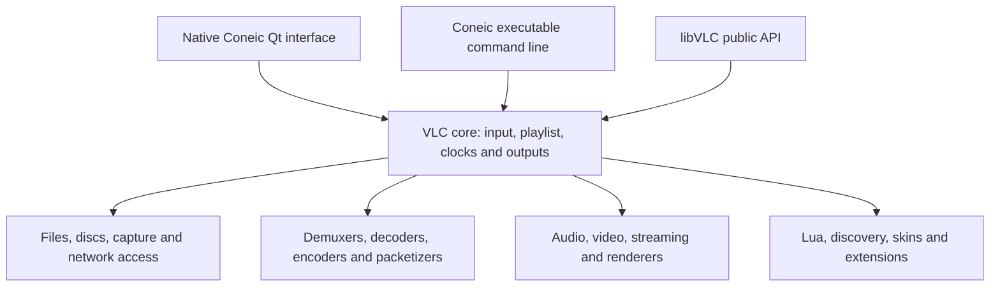

# Architecture and scope

Coneic builds VLC's native Windows executable, Qt interface, libVLC, core and plugins. It does not wrap another installed VLC executable, and it does not replace VLC with browser media APIs.

The baseline has 1,901 module source files and 479 module registrations. Original menus, action handlers, dialog implementations, shortcuts, option declarations and API identifiers are preserved. The source audit compares exact baseline blobs, declarations and selected workflow files; it is not a semantic proof of every path.

Presentation changes include the native Qt header, media Home screen, metadata-backed settings frontend, shared widget style and resources. A bounded asynchronous thumbnail service runs the same Coneic executable with VLC scene filtering; worker processes use native Windows paths and never embed a second libVLC player in the UI process. Windows executable resources and app-data names are changed for Coneic. The `%APPDATA%/coneic` directory separates file-based settings. The inherited Windows language selector still uses VLC's upstream registry preference. Internal `vlc` module/domain/API names remain compatible.

The logo is a supplied SVG with embedded raster layers. Exact copies and mechanical PNG/ICO exports are included. Resources map both ordinary and seasonal application-icon aliases to the supplied artwork. Interface icon aliases use attributed reference SVGs plus documented supplemental vectors. Original credits are retained.

The portable application retains advanced workflows and an unmodified ActiveX baseline DLL. Installation-time registration, file associations and shell integration are separate from portable desktop behavior.
